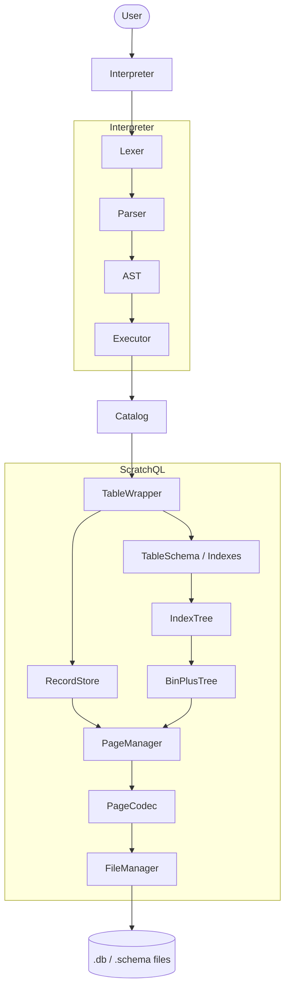
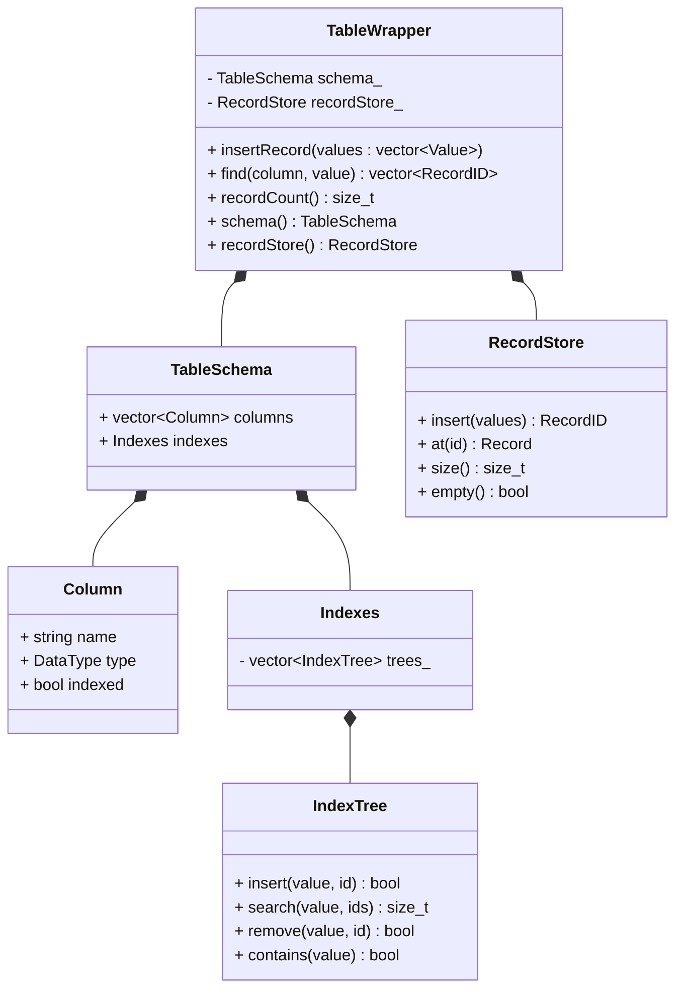
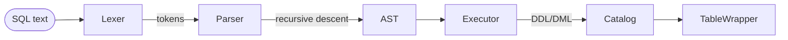

# ScratchQL — SQL Interpreter and Table Manager

A study project focused on building a small SQL language from scratch. The goal is
to understand, in practice, the concepts of **Information Organization and
Retrieval** — how data is written to disk, indexed and retrieved — as well as how
an **interpreter** works.

The project is split into two integrated fronts:

1. **Table Management** (`ScratchQL/`) — the storage engine: schema, records,
   indexes and the on-disk page stack.
2. **Interpreter** (`Interpreter/`) — parses user input (SQL text) and translates
   it into operations on the tables.

> For a detailed walkthrough of the storage engine (B+Tree, page layout and the
> flow between layers), see [`ScratchQL/HowWorks.md`](ScratchQL/HowWorks.md).

---

## Architecture



Each layer only knows about the layer immediately below it.

---

## Table Management

### Page stack (storage)

All storage is done in fixed-size pages (`PAGE_SIZE = 4096`), written to a binary
file. The layers, from the bottom up:

| Layer | Responsibility |
|-------|----------------|
| `FileManager` | Raw `seek`/`read`/`write` on the binary file. |
| `PageCodec` | Converts an in-memory page to/from its binary representation (little-endian). |
| `PageManager` | Maps a `PageID` to the offset `id * PAGE_SIZE`. |
| `BinPlusTree` | In-memory B+Tree: search, insert, split and delete. |

### Tables

A table is a dual structure: a **schema** (columns, types and which columns are
indexed), the **records** and one **index** per indexed column.



- **`RecordStore`** stores the rows in a B+Tree whose *leaves* hold the records
  themselves, keyed by `RecordID` (0-based, monotonic). Page 0 is a metadata page
  pointing to the root. It reuses the same page stack (`PageManager`/`PageCodec`).
- **`IndexTree`** wraps a `BinPlusTree`. Because the tree stores unique keys, the
  pair `(value, RecordID)` is encoded into a single key (length prefix + value +
  fixed-width id), which allows duplicate values per column.
- **`TableWrapper`** is the table facade: insertion, lookup by indexed column and
  access to the rows. When opened, it rebuilds the indexes from the persisted
  records. Note that `TableWrapper` is **neither copyable nor movable** (it holds a
  `RecordStore` with an open file), so the `Catalog` keeps it via
  `std::unique_ptr`.

### Data types

The types supported today are limited by the `DataType` enum:

```cpp
enum class DataType {
    Integer,   // INT / INTEGER
    Varchar    // VARCHAR / STRING / TEXT
};
```

The value actually stored is a `std::variant` (`Value`) that **already supports**
`int64_t`, `double`, `bool` and `std::string`; exposing types such as Float,
Boolean and Date in the DDL is future work (see *Next steps*).

### A table's files

Creating a table uses two complementary files:

| File | Contents |
|------|----------|
| `<name>.schema` | Text metadata: table name and column definitions (`column <name> <TYPE> [INDEXED]`). |
| `<name>.db` | Binary pages with the records (and the tree that indexes them). |

The `.schema` file is written/read by the interpreter's `SchemaFile` module; the
`.db` file is managed by `RecordStore`.

---

## Interpreter

The interpreter follows the classic compiler pipeline: **tokenizer → parser → AST
→ executor**.



- **`Lexer`** (`Lexer.cpp`): turns the string into `Token`s. Case-insensitive
  keywords, identifiers, integer/float/string literals (with `''` escaping), `--`
  line comments.
- **`Parser`** (`Parser.cpp`): *recursive descent* that produces the AST. Syntax
  errors are reported as `SqlError` with line and column.
- **`AST`** (`AST.h`): each command is a struct; `Statement` is a `std::variant`
  over them.
- **`Executor`** (`Executor.cpp`): walks the AST and drives the `Catalog` /
  `TableWrapper`, validating arity, types and the existence of tables/columns.
- **`Catalog`** (`Catalog.h`): owns the table directory. Loads the schemas on
  startup and keeps one open `TableWrapper` per table (via `unique_ptr`). Exposes
  `create`, `drop`, `open`, `exists` and `tableNames`.
- **`Interpreter`** (`Interpreter.h`): the single `execute(sql)` facade that
  combines lex, parse and execution — used by both the REPL and the tests.

### Supported SQL subset

```sql
CREATE TABLE t (c1 INT [INDEXED], c2 VARCHAR [INDEXED], ...);
DROP TABLE t;
INSERT INTO t VALUES (v1, v2, ...);
SELECT * | c1, c2 FROM t [WHERE col OP literal];   -- OP: = <> < <= > >=
```

- Equality (`=`) on an **indexed column** uses the index (`TableWrapper::find`);
  any other case does a full scan with predicate evaluation.
- There is **no** `DELETE` or `UPDATE` yet (`RecordStore` does not remove rows
  today).

### Module layout

```
Interpreter/
├── include/
│   ├── Token.h      Lexer.h      SqlError.h
│   ├── AST.h        Parser.h
│   ├── SchemaFile.h Catalog.h
│   ├── Result.h     Executor.h   Interpreter.h
├── src/
│   ├── Lexer.cpp    Parser.cpp   SchemaFile.cpp
│   ├── Catalog.cpp  Executor.cpp Interpreter.cpp
├── main.cpp                 REPL / script execution
└── unit_tests/interpreter_ut.cpp
```

---

## Building and running

Requirements: CMake ≥ 3.22 and a C++17 compiler.

```bash
# Option 1 — helper script: builds and opens the REPL
./build_run.sh

# Option 2 — via CMake presets
cmake --preset MyProject
cmake --build out/build/MyProject
./interpreter
```

The `interpreter` executable is generated at the repository root.

```bash
./interpreter                       # REPL (tables in ScratchQL/FolderTables)
./interpreter --dir <path>          # use <path> as the table directory
./interpreter -f script.sql         # run a command file and exit
```

Statements are terminated by `;`. Type `exit`/`quit` (or Ctrl-D) to leave.

### Tests

```bash
# Interpreter tests (via CTest)
ctest --test-dir out/build/MyProject --output-on-failure

# Storage engine tests (direct compile, see the file header)
g++ -std=c++17 -I ScratchQL/include \
    ScratchQL/unit_tests/table_ut.cpp ScratchQL/src/BinPlusTree.cpp \
    -o /tmp/table_ut && /tmp/table_ut
```

---

## Repository layout

```
.
├── ScratchQL/                # Storage engine
│   ├── include/              # FileManager, PageCodec, PageManager, Page,
│   │                         # BinPlusTree, RecordStore, IndexTree,
│   │                         # TableSchema, TableWrapper, baseline_common
│   ├── src/                  # BinPlusTree.cpp, FileHandler.cpp
│   ├── unit_tests/           # table_ut, storage_ut, PageManager_ut
│   ├── examples/             # simple_table_example.cpp
│   └── HowWorks.md           # technical deep dive on the storage
├── Interpreter/              # SQL interpreter (Lexer/Parser/Executor/Catalog)
├── Interface/                # Python experiments (legacy)
├── cli-terface.cpp           # old CLI (no longer compiles — kept for reference)
├── CMakeLists.txt            # Root build (ScratchQL + Interpreter)
└── CMakePresets.json
```

---

## Next steps

| Status | Item |
|--------|------|
| ✅ | Binary page stack (FileManager → PageManager → PageCodec) |
| ✅ | B+Tree (`BinPlusTree`): search, insert, split and delete |
| ✅ | `RecordStore` (rows in a B+Tree) and index rebuild on open |
| ✅ | `TableWrapper` and `IndexTree` (per-column index, duplicate values) |
| ✅ | Interpreter: `CREATE` / `DROP` / `INSERT` / `SELECT` |
| ❌ | `DELETE` / `UPDATE` (requires logical and physical row removal) |
| ❌ | Composite predicates (`AND`/`OR`) and more types (Float, Date, Boolean) |
| ❌ | Explicit primary/secondary keys and efficient non-indexed search |

---

## References

- [SQL commands — grouped by topic](https://algodaily.com/lessons/useful-sql-commands-with-examples)
- [CMake Presets](https://cmake.org/cmake/help/latest/manual/cmake-presets.7.html)
