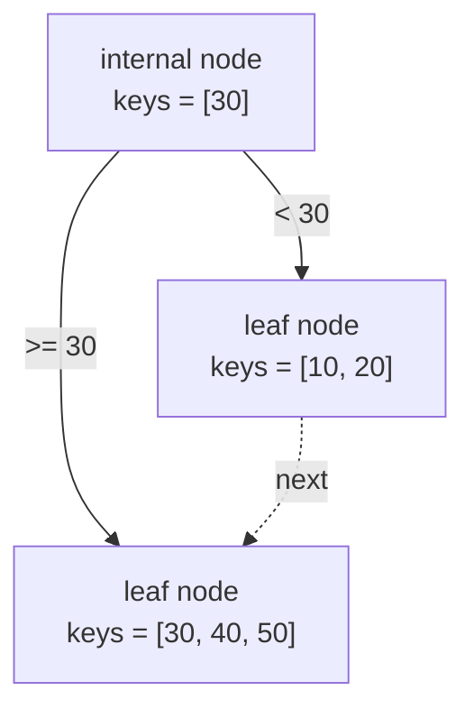
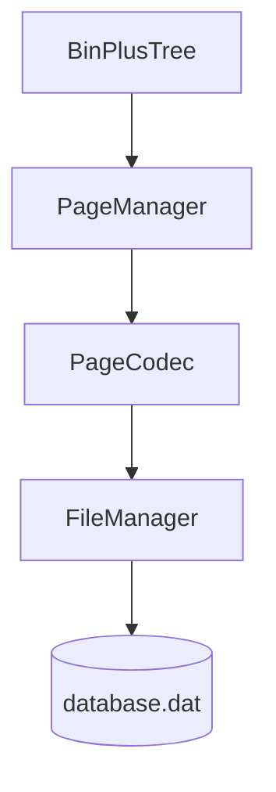
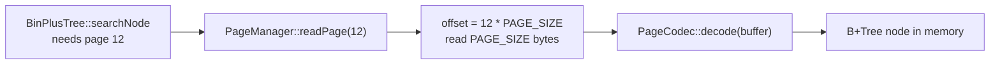
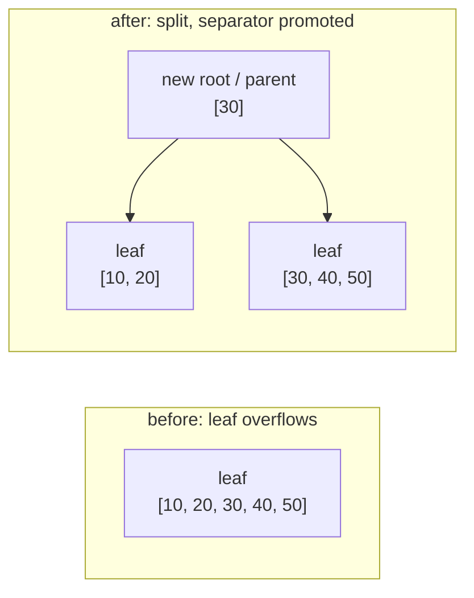
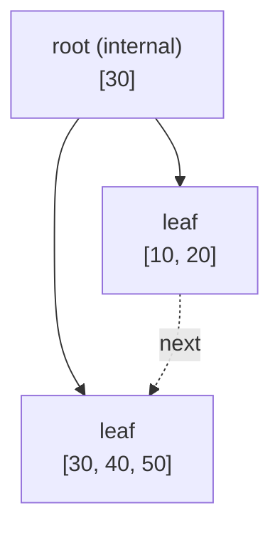
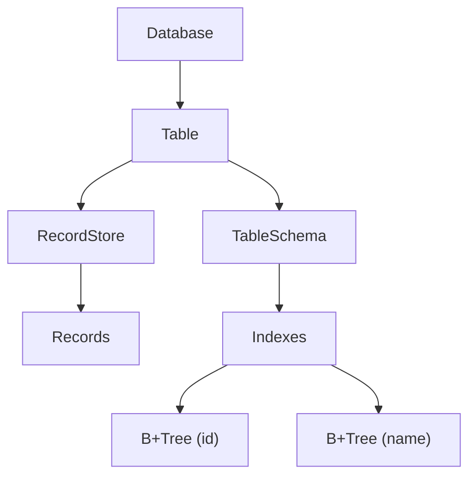

# How the Data is stored in a Tree for SQL ?

The data is stored in a tree struct, with indexed nodes, where each node contains a key and a pointer to its children.

In this project, we are going to implement a B+ Tree, which is a self-balancing tree data structure that keeps the data sorted and allows searches, seq. access, etc.

## B+ Tree Structure

A B+ Tree is a balanced, multi-way search tree. Every value lives in a **leaf** node, always kept sorted, and the leaf nodes are chained together so a range scan is a simple left-to-right walk. **Internal** nodes only route the search: each key in an internal node is a separator between two children.

In this implementation (`BinPlusTree.h`), a node is defined as:

```cpp
struct BinPlusTree::Node {
    bool isLeaf;
    std::string data;
    Node* parent;
    Node* next;                     // next leaf (sequential access)
    std::string keys[MAX_KEYS + 1];
    Node* children[MAX_KEYS + 2];
    std::size_t keyCount;
    std::size_t childCount;
};
```

- **Leaf nodes** hold the keys (`keys[]`) and leave `children[]` empty; `next` links one leaf to the following one.
- **Internal nodes** hold the routing keys and the child pointers, one more child than keys (`childCount == keyCount + 1`).

The tree order is fixed by `MAX_KEYS`: a node stores at most 4 keys (and an internal node at most 5 children). An insertion is allowed to push a node one over its limit; the node then **splits** in half, and the separator key is promoted to the parent. When the root splits, a new root is created and the tree grows one level taller.



`searchNode` descends from the root using the separators (`childIndex`, a binary search over the internal keys) until it reaches a leaf, where it performs `std::binary_search` over the sorted keys. Because every path has the same length, the tree stays balanced without rotations.

## Page layout

When the tree is persisted, each node is a **page** of `PAGE_SIZE = 4096` bytes. The binary format is shared by `Page.h` and `PageCodec.h` and is little-endian:

| Offset | Field | Size | Meaning |
|--------|-------|------|---------|
| 0 | `type` | 1 byte | node kind (`NODE_TYPE_LEAF`, `NODE_TYPE_INTERNAL`, ...) |
| 1 | `key_count` | 2 bytes | number of valid keys |
| 3 | `child_count` | 2 bytes | number of valid child references |
| 5 | `keys` | 8 bytes each | up to `key_count` keys (`uint64_t`) |
| 5 + keys | `children` | 8 bytes each | up to `child_count` child page ids (`PageID`) |
| ... | free | remaining | unused space inside the 4096-byte page |

The general page kinds are declared in `baseline_common.h`:

```cpp
enum class PageType : uint8_t {
    InternalNode = 1,
    LeafNode = 2,
    Record = 3,
    Free = 4
};
```

`PageCodec::encode` writes a `Page` into such a buffer (zero-filling the rest), and `PageCodec::decode` reads it back. Both validate the buffer size and throw instead of leaving a corrupted page in memory.

## Layers and data flow

The storage is organized as layers — each one only knows about the one below it:



- `BinPlusTree` — in-memory logic: search, insert, split, delete.
- `PageManager` — maps a `PageID` to a byte offset (`id * PAGE_SIZE`) and reads/writes a whole page.
- `PageCodec` — converts between the in-memory `Page` and its binary representation.
- `FileManager` — the actual seek/read/write on the binary file.

A single lookup therefore crosses every layer:



The same path runs backwards on insert: build/update the node in memory, `PageCodec::encode` it into a page buffer, and `PageManager::writePage` it back to disk.

## Operations

**Search** — start at the root; while the node is internal, pick the child whose separator range contains the key; at the leaf, binary-search for the key. Returns whether it exists; O(log n) page accesses.

**Insert** — first check for a duplicate (the tree is a set of keys). Then descend to the correct leaf, insert the key in sorted order, and shift the remaining keys. If the leaf overflows (`keyCount > MAX_KEYS`), split it in half, link the new leaf after the old one with `next`, and return the new node to the parent. The parent inserts the promoted separator and, if it overflows too, splits as well — the split propagates upward. If the root splits, a new internal root is created:



**Delete** — locate the key, remove it from the leaf, and compact the slot. Deletion is intentionally simple: instead of rebalancing/merging, an empty subtree is removed from its parent, and an internal root left with a single child is collapsed into that child. This keeps the code small at the cost of not guaranteeing a minimum fill factor.

## Worked example

Inserting `10, 20, 30, 40, 50` into an empty tree, one key at a time:

1. `10, 20, 30, 40` fill a single root leaf (≤ `MAX_KEYS`).
2. `50` makes the leaf hold 5 keys → it splits into `[10, 20]` and `[30, 40, 50]`.
3. The promoted separator `30` creates a new root:



Searching `40` reads the root (`40 >= 30` → go right), then binary-searches the right leaf.


## 
The data table is organized in a dual structure, where the table schema is stored in a B+ Tree and the records are stored in a RecordStore. The RecordStore is also organized as a B+ Tree, where each record is stored in a leaf node.




## Complexity

| Operation | Time | Notes |
|-----------|------|-------|
| Search | O(log n) | height ≈ log<sub>order</sub>(n); one page read per level |
| Insert | O(log n) | descend + at most one split per level, propagated to the root |
| Delete | O(log n) | descend + local compaction |

Here `n` is the number of keys. The leaves are sorted and linked, so iterating a whole index is O(n) with sequential access.
